<picture>
  <source media="(prefers-color-scheme: dark)" srcset="assets/banner-dark.svg">
  
</picture>

<picture>
  <source media="(prefers-color-scheme: dark)" srcset="assets/profile-dark.svg">
  
</picture>

<picture>
  <source media="(prefers-color-scheme: dark)" srcset="assets/activity-dark.svg">
  
</picture>

This is my work account at Qilin Lab, where my commits live in private repos. My personal account is [@devanshc777](https://github.com/devanshc777), which carries the same page with its own avatar. The graph above adds both together. Every panel is an SVG rebuilt daily from live GitHub data.

### Latest builds

<!-- projects:start -->
| | |
|---|---|
| **[resnet-degradation](https://github.com/devanshc777/resnet-degradation)** Python | **[computing-life](https://github.com/devanshc777/computing-life)** Genetic algorithms, hill climbing and simulated annealing race to build Game of Life objects from random 16x16 seeds. 8-bit browser demo + benchmark, zero dependencies. |
| **[180dc-muj-website](https://github.com/devanshc777/180dc-muj-website)** 180 Degrees Consulting MUJ — official website, 2026 | **[music-fetch](https://github.com/devanshc777/music-fetch)** Claude Code skill: pull audio from YouTube/yt-dlp sources into a local music inbox for dj-holo |
| **[dj-study](https://github.com/devanshc777/dj-study)** Claude Code skill: study DJ technique from YouTube transcripts into notes and reproducible dj-holo settings | **[yt-vault](https://github.com/devanshc777/yt-vault)** Local YouTube transcript vault: yt-dlp CLI + FastAPI reading room, saves clean markdown notes |
<!-- projects:end -->

**Open source:** [Apicurio Registry](https://github.com/Apicurio/apicurio-registry) (CNCF Sandbox): [#9965](https://github.com/Apicurio/apicurio-registry/pull/9965) merged.

[LinkedIn](https://www.linkedin.com/in/devansh-chowdhary-4022131ba)
